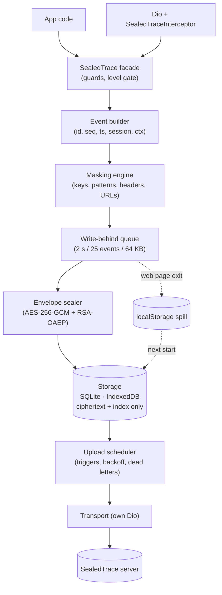
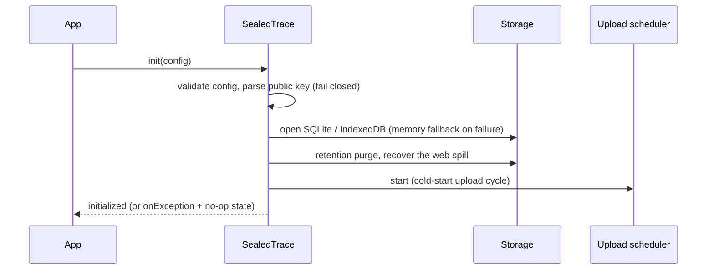
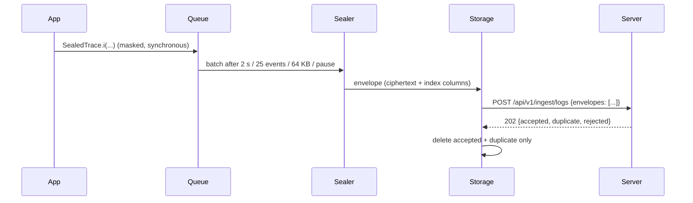

# sealed_trace 🔐

[](https://pub.dev/packages/sealed_trace)
[](https://github.com/rsagar024/sealed_trace/blob/master/LICENSE)

**A logging SDK for Flutter and Dart that masks personal data on the device, seals every batch with encryption only
your SealedTrace server can open, keeps it offline and uploads it reliably, and never throws into your app.**

```dart
await SealedTrace.init(const SealedTraceConfig(
  baseUrl: 'https://logs.example.com',
  projectId: 'my-project',
  apiKey: 'sk_live_…',
  publicKeyPem: projectPublicKeyPem,   // RSA-2048, from the SealedTrace console
  appName: 'shop',
));

SealedTrace.i('checkout', 'order placed by asha@example.com', meta: {'orderId': 'o-123'});
// stored and sent as ciphertext; the email is already "***" before it is queued
await SealedTrace.flush();
```

One package, one import, on Android, iOS, web, Windows, macOS and Linux:

- `SealedTrace` is the static facade.
- `SealedTraceConfig` and four sub-configs configure it.
- `SealedTraceInterceptor` logs Dio calls.
- `UploadResult` and `DiagnosticSnapshot` report what happened.

The device holds **only the public key**: nothing in the SDK can read a stored log back.

> ⚠️ **Security review pending.** The AES-256-GCM and RSA-OAEP code is this package's own pure Dart. It is tested
> against Node and OpenSSL, but it has **not had an independent security review** and is not constant-time. Read
> [Security model](#security-model) before using it for sensitive data.

<a id="install"></a>

## 🚀 Install

```yaml
dependencies:
  sealed_trace: ^1.0.0
```

```dart
import 'package:sealed_trace/sealed_trace.dart';
```

That single library exports:

- `SealedTrace`;
- `SealedTraceConfig`, `MaskConfig`, `UploadConfig`, `RetentionConfig` and `NetworkLogConfig`;
- `LogLevel`, `SealedTraceEnv` and `LogEvent`;
- `UploadResult`, `UploadOutcome` and `DiagnosticSnapshot`;
- `SealedTraceInterceptor`.

Nothing else needs importing.

<a id="why"></a>

## ✨ Features

- 🙈 **Masking on the device:** values under sensitive keys (`password`, `token`, `email`, `phone`, …) and text that
  looks like an email, card number, phone number or coordinates become `***` *before* the event is queued. You can add
  your own keys and patterns.
- 🔒 **Hybrid encryption per batch:** up to 25 events (or 64 KB) are encrypted with AES-256-GCM using a fresh key,
  wrapped with your project's RSA-2048 public key (RSA-OAEP, SHA-256).
- 💾 **Offline, ciphertext only:**
  - storage is SQLite (drift) on Android, iOS and desktop, and IndexedDB in the browser;
  - only the sealed envelope plus a few index columns (counts, sequence and time ranges, levels) are stored;
  - retention limits the count, age and size.
- 📡 **Reliable upload:**
  - the triggers are an interval, a size threshold, app resume, connectivity restored, and `flush()`;
  - failed uploads are retried with exponential backoff and jitter;
  - after 5 failed attempts an envelope becomes a dead letter;
  - rows are deleted only after the server acknowledges them.
- 🌐 **Dio interceptor:** every call becomes one masked `network` event. The request and response are never altered,
  and calls to the SealedTrace server itself are never logged.
- 🧯 **Never throws, zero cost when off:** every public call is guarded. With `enabled: false`, or below `minLevel`, a
  call returns before anything is allocated.
- 🚪 **Survives leaving the page on the web:** queued events are sealed synchronously into a `localStorage` spill
  (ciphertext only) when the tab is hidden or closed, and moved to IndexedDB at the next start.
- 🩺 **Diagnostics without content:** counters for accepted, dropped, sealed, stored and uploaded events, plus the
  `onException` and `onUploadResult` callbacks.
- 🔌 **Pluggable transport:** `UploadConfig.httpClientAdapter` for a proxy, custom certificates or a mock server.

<a id="contents"></a>

## 📑 Contents

- [Platform matrix](#platform-matrix) · [Requirements](#requirements) · [Quick start](#quick-start)
- [Configuration](#configuration) · [API overview](#api-overview) · [Getting your keys](#getting-your-keys)
- [Platform setup](#platform-setup) · [Security model](#security-model) · [Architecture](#architecture)
- [Status](#status) · [Example app](#example-app) · [Migration notes](#migration-notes)
- [Development](#development) · [Further reading](#further-reading) · [License](#license)

<a id="platform-matrix"></a>

## 🗂️ Platform matrix

| Platform | Storage | Sealing large batches | Final flush when the app goes away | Verified |
|---|---|---|---|---|
| Android | SQLite (drift), WAL | background isolate above 8 KB | `paused` / `inactive` / `detached` flush the queue | ✅ emulator (Android 16, debug + release/R8), one phone ¹ |
| iOS | SQLite (drift) | background isolate above 8 KB | `paused` / `inactive` flush the queue | ⏳ not run ² |
| Web | IndexedDB + `localStorage` spill | main thread | `visibilitychange` / `pagehide` seal into the spill synchronously | ✅ Chrome, Edge, Firefox (headless) ³ |
| Windows | SQLite (drift), WAL | background isolate above 8 KB | `detached` flushes; the 2 s write-behind covers the rest | 🧪 Dart VM only ⁴ |
| macOS | SQLite (drift) | background isolate above 8 KB | as Windows | ⏳ not run ² |
| Linux | SQLite (drift) | background isolate above 8 KB | as Windows | ⏳ not run ² |

¹ On the emulator: SQLite from the default build hook, masking, upload, restart persistence, connectivity off and
on, and exits. The phone (Samsung, Android 16) ran in a debug build with in-memory storage, because SQLite could not
be downloaded on that machine at the time.
² Code paths are shared with Android and Windows; nothing has run on these platforms yet.
³ Storage across a real page reload, the quota error path (Firefox), and real navigation and tab close.
Safari has not been tested.
⁴ The desktop build is blocked on the test machine by an incomplete Visual Studio install. Storage, WAL, corruption
recovery and the memory fallback are tested on the Dart VM on Windows.

<a id="requirements"></a>

## ✅ Requirements

| | Minimum |
|---|---|
| Flutter / Dart | Flutter **3.38.1+** / Dart **3.10+** |
| Android | **minSdk 24** (Flutter's default), `INTERNET` and `ACCESS_NETWORK_STATE` in the main manifest |
| iOS / macOS | no extra setup on iOS; macOS needs the `com.apple.security.network.client` entitlement |
| Web | any modern browser with IndexedDB; the server must allow CORS for `X-Api-Key` and `Content-Type` |
| Desktop / mobile SQLite | the `sqlite3` build hook downloads a prebuilt library at build time (see [Platform setup](#platform-setup)) |

Two rules to know up front:

- **Declare `INTERNET` in your release manifest.** Flutter adds it only to debug builds, so a release APK without it
  logs fine but never uploads.
- **On the web, the server must answer CORS preflights** for `POST` with `X-Api-Key` and `Content-Type`, or every
  upload fails as a network error.

<a id="quick-start"></a>

## 📖 Quick start

1. Add the dependency:
   ```yaml
   dependencies:
     sealed_trace: ^1.0.0
   ```
2. Do the [platform setup](#platform-setup): Android permissions, the macOS entitlement, and CORS on your server for
   the web.
3. At startup, listen for problems, then initialize:
   ```dart
   Future<void> main() async {
     WidgetsFlutterBinding.ensureInitialized();
     SealedTrace.onException = (error, stack) {
       // The SDK never throws into your app; problems are reported here.
     };
     await SealedTrace.init(const SealedTraceConfig(
       baseUrl: 'https://logs.example.com',
       projectId: 'my-project',
       apiKey: 'sk_live_…',
       publicKeyPem: projectPublicKeyPem,
       appName: 'shop',
       env: SealedTraceEnv.prod,
       minLevel: LogLevel.info,
     ));
     runApp(const MyApp());
   }
   ```
4. Log anywhere. Every call returns at once and never throws:
   ```dart
   SealedTrace.v('cache', 'hit', meta: {'key': 'home'});
   SealedTrace.d('cache', 'miss');
   SealedTrace.i('auth', 'signed in');
   SealedTrace.w('sync', 'retrying');
   SealedTrace.e('payment', 'charge failed', error: e, stack: s);
   SealedTrace.f('app', 'unrecoverable', error: e, stack: s);
   ```
5. Optionally, attach the user and the Dio interceptor, and clear on sign-out:
   ```dart
   SealedTrace.setUser('user-42');                        // an opaque id, never an email or a name
   final dio = Dio()..interceptors.add(SealedTraceInterceptor());

   await SealedTrace.clearLocalLogs();                    // on sign-out
   SealedTrace.setUser(null);
   ```

<a id="configuration"></a>

## ⚙️ Configuration

### `SealedTraceConfig`

| Field | Default | Meaning |
|---|---|---|
| `baseUrl` | required | Absolute `http(s)` URL of the SealedTrace server. Trailing slashes are ignored. |
| `projectId` | required | Project the envelopes belong to. |
| `apiKey` | required | Sent only as the `X-Api-Key` header. |
| `publicKeyPem` | required | The project's RSA-2048 public key, SPKI (`BEGIN PUBLIC KEY`) or PKCS#1 (`BEGIN RSA PUBLIC KEY`). An invalid key leaves the SDK disabled. |
| `appName` | required | Your app's name. |
| `env` | `SealedTraceEnv.prod` | `dev`, `staging` or `prod`; reported in every event. |
| `minLevel` | `LogLevel.verbose` | Events below this level are dropped before anything is built. |
| `enabled` | `true` | `false` makes every call a no-op: no queue, timer, storage or listener. |
| `maskConfig` | `MaskConfig()` | [Masking](#maskconfig). |
| `uploadConfig` | `UploadConfig()` | [Uploads](#uploadconfig). |
| `retentionConfig` | `RetentionConfig()` | [Retention](#retentionconfig). |
| `networkLogConfig` | `NetworkLogConfig()` | [Dio interceptor](#networklogconfig). |
| `verboseInternalLogs` | `false` | Prints the SDK's own diagnostics with `debugPrint`. These never contain log content. |
| `databaseDirectory` | `null` | Where the SQLite file lives. Defaults to the application support directory. Pure-Dart apps must set it, or the SDK uses memory storage. |

<a id="maskconfig"></a>

### `MaskConfig`

| Field | Default | Meaning |
|---|---|---|
| `extraKeys` | `[]` | More keys whose values are replaced. Matching is exact and case-insensitive on the whole key. |
| `extraPatterns` | `[]` | More `RegExp`s applied to every string. |
| `extraHeaderDenylist` | `[]` | More header names to mask in network logs. |
| `useDefaultKeys` | `true` | `password`, `pass`, `pwd`, `token`, `secret`, `auth`, `apikey`, `api_key`, `access_token`, `refresh_token`, `firstName`, `lastName`, `name`, `first_name`, `last_name`, `fName`, `lName`, `email`, `phone`, `dob`, `ssn`, `cvv` |
| `useDefaultPatterns` | `true` | Email addresses; card numbers (13–19 digits, Luhn-valid or grouped like a card); latitude/longitude pairs; Indian and US phone numbers. |
| `replacement` | `'***'` | Replacement text. |

The headers `Authorization`, `Cookie`, `Set-Cookie` and `X-Api-Key` are always masked in network logs, even with
`useDefaultKeys: false`.

<a id="uploadconfig"></a>

### `UploadConfig`

| Field | Default | Meaning |
|---|---|---|
| `interval` | 15 min | Periodic upload. |
| `sizeThresholdEvents` | 200 | Upload once this many events are stored (0 disables the trigger). |
| `sizeThresholdBytes` | 256 KB | Upload once this many bytes are stored (0 disables the trigger). |
| `maxAttempts` | 5 | Failed attempts before an envelope is dead-lettered. |
| `batchSize` | 50 | Envelopes per request. Values above 50 are clamped to 50. |
| `requestTimeout` | 30 s | Per request. |
| `backoffBase` | 5 s | Retry delay `min(base·2^(n−1), 5 min)`, with jitter between 0.5× and 1×. |
| `uploadOnResume` | `true` | Upload when the app returns to the foreground. |
| `uploadOnConnectivityRestored` | `true` | Upload when the network comes back. |
| `httpClientAdapter` | `null` | A Dio `HttpClientAdapter` for the SDK's own uploads: a proxy, custom certificates, or a mock server. Only the connection layer changes; the URL, headers and timeouts stay the same. |

<a id="retentionconfig"></a>

### `RetentionConfig`

| Field | Default | Meaning |
|---|---|---|
| `maxEvents` | 10 000 | Most events kept on the device. |
| `maxAgeDays` | 30 | Oldest age kept. |
| `maxSizeBytes` | 50 MB | Most stored bytes. |
| `purgeInterval` | 1 h | How often retention runs. It also runs at start and after each upload cycle. |
| `deadLetterTtl` | 7 days | How long envelopes that gave up are kept. They are retried once per app start. |

Retention removes the oldest envelopes first. If storage is full, the oldest 20% are purged and the write is retried
once.

<a id="networklogconfig"></a>

### `NetworkLogConfig`

| Field | Default | Meaning |
|---|---|---|
| `enabled` | `true` | `false` makes the interceptor a pure pass-through. |
| `maxBodyChars` | 20 000 | Bodies are truncated **after** masking. |
| `hostAllowlist` | `[]` | Hosts to log; empty means all. `*.example.com` matches subdomains but not `example.com` itself. |
| `captureRequestBody` | `true` | Log request bodies. |
| `captureResponseBody` | `true` | Log response bodies. |

<a id="api-overview"></a>

## 🧭 API overview

```dart
// Lifecycle: never throws.
await SealedTrace.init(config);        // idempotent: a second call returns the first call's future
SealedTrace.isInitialized;             // true once init has finished with a valid config
await SealedTrace.dispose();           // drains the queue, closes storage; init may be called again

// Logging: six levels, or a full LogEvent.
SealedTrace.i('tag', 'message', meta: {'key': 'value'});
SealedTrace.e('tag', 'message', error: error, stack: stack);
SealedTrace.log(LogEvent(level: LogLevel.warning, tag: 'tag', message: 'message'));

// Context: these do nothing before init has completed.
SealedTrace.setUser('user-42', name: 'Asha');   // the name is always stored as "***"
SealedTrace.setContext({'plan': 'pro'});
SealedTrace.addMaskKeys(['iban']);
SealedTrace.addMaskPattern(RegExp(r'\bORD-\d{6}\b'));

// Delivery and local data.
final UploadResult result = await SealedTrace.flush();   // outcome, accepted, duplicate, rejected, failed
await SealedTrace.clearLocalLogs();                      // the only local removal tool

// Observability: no log content in any of these.
SealedTrace.onException = (error, stack) {};
SealedTrace.onUploadResult = (UploadResult result) {};
final DiagnosticSnapshot d = SealedTrace.diagnostics;

// Dio.
final dio = Dio()..interceptors.add(SealedTraceInterceptor());
```

| Concept | Details |
|---|---|
| Levels | `verbose < debug < info < warning < error < fatal`. `fatal`, and `error` outside `prod`, are sealed at once; everything else waits in the write-behind queue. |
| Write-behind queue | In memory, never on disk in plaintext. It is flushed after 2 s, at 25 events or at 64 KB, and when the app is paused, hidden or detached. |
| Sealing | One queue batch becomes one envelope (one `batchId`). Plaintext JSON → AES-256-GCM (fresh key, 12-byte IV) → RSA-OAEP key wrap. Batches over 8 KB are encrypted in a background isolate on native platforms. If sealing fails, the batch is dropped and counted, never stored in plaintext. |
| Storage | Only ciphertext and index columns are stored. `seq` keeps counting across restarts. A corrupt database is set aside and recreated; if storage can't be opened at all, the SDK falls back to memory and reports it. |
| Upload triggers | Interval, size threshold, app resume, connectivity restored, `flush()`, and once at start. One cycle runs at a time. Offline cycles are skipped without using an attempt. |
| Retries | Exponential backoff with jitter. After 5 failed attempts an envelope becomes a dead letter, retried once per app start and kept for 7 days. |
| Server answers | `202` → delete only the `accepted` and `duplicate` ids. `401`/`403` → pause uploads until the next `init`; data is kept. `413` → halve the request. `429` → wait for `Retry-After`. Anything else → retry later. |
| Dio interceptor | One `network` event per call, masked: URL, headers, bodies (JSON keys, form fields, bearer tokens), status and duration. Levels: 2xx is `debug`, 4xx is `warning`, and 5xx or no response is `error`. |
| Web page exit | `visibilitychange` (hidden) and `pagehide` seal the queue synchronously into `localStorage`. The spill moves to IndexedDB at once, or at the next start. |
| Lifecycle | `init` is idempotent; to change the config, call `dispose` then `init`. Calls made before `init` finishes are dropped. |
| Testing | `UploadConfig(httpClientAdapter: …)` points uploads at a fake server; `enabled: false` turns the SDK off completely. |

### `UploadOutcome`

| Value | Meaning |
|---|---|
| `success` | Every attempted envelope was acknowledged. |
| `partial` | Some envelopes were acknowledged and some were not. |
| `failed` | Nothing was acknowledged. |
| `skipped` | Nothing was attempted: nothing pending, disabled, offline, a backoff wait, or another cycle already sent it. |
| `unauthorized` | The server rejected the API key (401 or 403). Uploads are paused until the next `init`. |

### `DiagnosticSnapshot`

| Counter | Counts |
|---|---|
| `eventsAccepted` | Events that passed the level gate and were queued. |
| `eventsDroppedLevel` | Events below `minLevel`. |
| `eventsDroppedQueueFull` | Events dropped because the in-memory queue was full (5 000). |
| `sealFailures` | Batches that could not be sealed (dropped, never stored in plaintext). |
| `storageFailures` | Storage errors, including the memory fallback. |
| `uploadAttempts` / `uploadFailures` | Upload requests, and failed requests. |
| `envelopesDeadLettered` | Envelopes that gave up after `maxAttempts`, or were rejected for good. |
| `purgedRows` | Envelopes removed by retention. |
| `internalExceptions` | Errors caught inside the SDK. |

### What `onException` reports

| Situation | What you get | What the SDK does |
|---|---|---|
| Invalid config | `StateError` listing the problems | stays uninitialized |
| Invalid public key | `StateError('Invalid publicKeyPem: …')`, without the key material | stays uninitialized; nothing is ever stored |
| SQLite or IndexedDB can't be opened | the storage error | continues with memory storage |
| A batch can't be sealed | the crypto error | drops that batch and counts it |
| `401` or `403` from the server | one `StateError`, without the API key | pauses uploads; keeps the data |
| A callback of yours throws | your error | carries on |

**Never-throw guarantees:**

- Every public method is wrapped in a guard.
- Asynchronous work runs in guarded zones.
- Transport errors are reduced to a category, so a Dio exception carrying your headers is never passed on.
- `init` returns normally even when it fails.

<a id="getting-your-keys"></a>

## 🔑 Getting your keys

| Config field | Where it comes from | Notes |
|---|---|---|
| `baseUrl` | your SealedTrace server | `https` in production (Android blocks cleartext by default). |
| `projectId` | SealedTrace console, project settings | One per app or environment. |
| `apiKey` | SealedTrace console, API keys | Sent only as `X-Api-Key`; a rejected key pauses uploads and is reported. |
| `publicKeyPem` | SealedTrace console, project encryption key | RSA-2048, SPKI or PKCS#1 PEM. The **private** key stays on the server; never put it in an app. |

- Use different keys for `dev`, `staging` and `prod`, and set `env` to match.
- The test key in `test/helpers/test_keys.dart` is **public on purpose** (it checks the vectors). Never use it for real
  data.
- The example app uses a demo-only public key whose private key was never saved.

<a id="platform-setup"></a>

## 📲 Platform setup

### Android

```xml
<!-- android/app/src/main/AndroidManifest.xml: the debug manifest has INTERNET, release builds need it here -->
<uses-permission android:name="android.permission.INTERNET" />
<uses-permission android:name="android.permission.ACCESS_NETWORK_STATE" />
```

- Use an `https` `baseUrl`. Android blocks plain HTTP unless you add a network security config.
- Release builds with R8 need no keep rules for this package.

### iOS and macOS

- iOS needs no extra setup.
- macOS: add `com.apple.security.network.client` = `true` to both `DebugProfile.entitlements` and
  `Release.entitlements`.

### SQLite (Android, iOS, Windows, macOS, Linux)

The `sqlite3` package's build hook downloads a prebuilt SQLite from `release-assets.githubusercontent.com` while the
app builds. If your network blocks that host, configure the hook in **your app's** `pubspec.yaml`: either use a mirror
through its `url_pattern` user-define, or, on desktop, the system library:

```yaml
hooks:
  user_defines:
    sqlite3:
      source: system
```

`source: system` does not work on Android, where the system `libsqlite3.so` cannot be loaded. Whatever the cause, if
SQLite can't be opened the SDK reports it through `onException` and keeps logging in memory.

### Web

- Storage is IndexedDB. No `sqlite3.wasm` or worker scripts are needed.
- The server must allow cross-origin `POST` with the `X-Api-Key` and `Content-Type` headers.
- Leaving the page seals the queue into `localStorage` (ciphertext only, capped at 1 M characters) because browsers
  drop asynchronous writes made while a page is going away.

<a id="security-model"></a>

## 🔐 Security model

**What is protected**

1. Masking runs on the caller's side before an event is queued, over the message, error, stack trace, metadata and
   your own context values.
2. Every batch is encrypted with a fresh AES-256-GCM key, wrapped with the project's RSA-2048 public key.
3. Only ciphertext and index columns (counts, sequence and time ranges, levels) are stored or sent.
4. The device holds no private key. No API returns stored logs; `clearLocalLogs()` is the only local removal.
5. The API key appears only in the `X-Api-Key` header, never in errors, logs or diagnostics.

**Limits you should know**

- **Up to 2 seconds of events can be lost** if the process dies without a lifecycle event, for example a crash, a
  force-stop, or a killed desktop window.
- **Masking is defense in depth, not a guarantee.** Known gaps:
  - US numbers written as 10 bare digits or with dots are not recognised.
  - Free-text addresses and names inside text are not recognised.
  - Secrets with no recognisable key or scheme are not detected.
  - A 10-digit number starting with 6–9 is treated as an Indian phone number and masked.
  - A long numeric id that happens to pass the Luhn check is masked as a card.
- **Keys outside the default list are not masked in your own `meta`**, for example `authorization` or `username`. A
  bearer token you log by hand stays encrypted, but the server sees it. Add such keys with `extraKeys` or
  `addMaskKeys`. (The Dio interceptor masks credential headers and bearer tokens in bodies on its own.)
- **`userId`, `tag` and the device context are never masked.** Don't put personal data in them. A name passed to
  `setUser(name:)` is always replaced with `***`.
- **The crypto has not been audited and is not constant-time.** Every envelope uses a fresh key once, and only the
  public-key operation runs on the device, which limits the exposure but does not remove it.

<a id="architecture"></a>

## 🏗️ Architecture

### Pipeline



| Layer | Owns | Must not |
|---|---|---|
| Facade | Static API, init/dispose, level and enabled gating, callbacks, guards | Do I/O on the caller's path, block, or throw |
| Event builder | Stamping id, `seq`, timestamp, session, user and context | Hold state beyond counters |
| Masking engine | All redaction of messages, errors, stacks, metadata, headers, URLs and bodies | Run after sealing, or drop events silently |
| Write-behind queue | Batching by time, count and bytes; flushing on lifecycle events | Persist plaintext |
| Envelope sealer | Serializing, encrypting, wrapping the key, computing index columns | Keep keys or plaintext after returning |
| Storage | Appending, purging, reading envelopes for upload, bookkeeping | Decrypt, or expose decrypted content |
| Upload scheduler | When and what to send, retries, dead letters, deleting after acknowledgement | Decrypt, or log its own calls |
| Transport | HTTP, the contract's JSON, status mapping | Contain retry policy |

### Runtime flows





### Envelope format and ingest contract

```json
{
  "v": 1,
  "batchId": "uuid-v4",
  "projectId": "my-project",
  "createdAt": "2026-01-01T10:00:00.000Z",
  "eventCount": 25,
  "alg": "RSA-OAEP-2048-SHA256+AES-256-GCM",
  "wrappedKey": "<base64, 256 bytes>",
  "iv": "<base64, 12 bytes>",
  "tag": "<base64, 16 bytes>",
  "ciphertext": "<base64>"
}
```

| Item | Value |
|---|---|
| Plaintext | Compact JSON array of events, UTF-8. |
| AES-256-GCM | Fresh 32-byte key and 12-byte IV per envelope, no AAD, 16-byte tag stored separately. |
| Key wrap | RSA-OAEP, SHA-256 with MGF1-SHA-256, empty label; `wrappedKey` is 256 bytes. |
| Request | `POST {baseUrl}/api/v1/ingest/logs` with `X-Api-Key` and `Content-Type: application/json`; at most 50 envelopes and 2 MB per request; 30 s timeout. |
| Response | `202` with `accepted`, `duplicate` and `rejected[{batchId, reason}]`; unknown fields are ignored. |
| Vectors | [`test/vectors/envelope_vectors.json`](https://github.com/rsagar024/sealed_trace/blob/master/test/vectors/envelope_vectors.json): known-answer cases and complete envelopes, with a test-only key, for server implementers. |

<a id="status"></a>

## 📊 Status

### Runtime dependencies

| Package | Version | Used for |
|---|---|---|
| `drift` + `sqlite3` | 2.35.3 / 3.8.0 | SQLite storage on Android, iOS and desktop (native only) |
| `dio` | 5.11.1 | The SDK's own transport, and the interceptor API |
| `connectivity_plus` | 7.3.2 | Connectivity-restored trigger and `ctx.network` |
| `path_provider` / `path` | 2.1.6 / 1.9.1 | Database location |
| `package_info_plus` | 10.2.2 | `appVersion` and `buildNumber` in the context |
| `crypto` | 3.0.8 | SHA-256 for RSA-OAEP and MGF1 (AES and RSA are this package's own code) |
| `uuid` | 4.6.0 | Event and batch ids |
| `web` | ≥ 0.5.1 < 2.0.0 | IndexedDB, `localStorage` and page events on the web |
| `meta` | 1.19.0 | `@internal` / `@visibleForTesting` |

The floor of every constraint is the version above, which was the latest release when 1.0.0 was prepared.

### Verification state

- **Tests:** 849 tests on the Dart VM, with core line coverage of **98.57%**, enforced by
  `tool/coverage/check_coverage.dart`.
- **Ingest contract:** every item (C1–C20) has an end-to-end test against a scripted server.
- **No plaintext:** a regression test scans the database files, spill, errors, logs and requests for plaintext.
- **Crypto:** AES-GCM and RSA-OAEP match Node and OpenSSL, including the dart2js build.
- **Platforms:**
  - browsers: Chrome, Edge and Firefox, headless;
  - Android: the emulator in debug and release, and one phone.
  - Not yet: iOS, macOS, Linux, a Windows desktop build, Safari, and a low-end device.
- **Server:** **never run against the real SealedTrace server.** Every contract test uses a scripted fake that follows
  the documented contract.

<a id="example-app"></a>

## 📱 Example app

The [`example/`](https://github.com/rsagar024/sealed_trace/blob/master/example) app is a one-screen tour:

- all six levels;
- a log with personal data (shown masked);
- `minLevel` and `enabled` switches (re-init with `dispose` + `init`);
- Flush and Clear;
- live diagnostics and the last upload result;
- the Dio interceptor against a mock API.

```sh
cd example
flutter run                                   # Android, iOS, web, Windows, macOS, Linux
flutter test integration_test -d <device>     # drives the demo on a device or emulator
```

It runs **offline**: uploads go to a mock ingest server plugged in through `UploadConfig(httpClientAdapter: ...)`, and
the API key and public key are demo placeholders. One button sends a single, optional, real request to
`httpbin.org`.

<a id="migration-notes"></a>

## 🔄 Migration notes

- **1.0.0 is the first release.** There is nothing to migrate from.
- The version follows semantic versioning: the public API in `package:sealed_trace/sealed_trace.dart` is stable within
  1.x, and breaking changes will come as 2.0.0.
- The envelope format is `v: 1`. A future format change will bump `v`, and servers should check it.

<a id="development"></a>

## 🛠️ Development

```sh
flutter pub get
dart analyze --fatal-infos
dart format --output=none --set-exit-if-changed .
flutter test --coverage && dart run tool/coverage/check_coverage.dart   # core coverage gate (90%)

dart compile js -O2 -o build/web_check/check.js tool/web_check/check.dart
node tool/web_check/drive.js chrome            # also: edge, firefox (real headless browsers)

cd example && flutter test integration_test -d <device>   # drives the example on a device or emulator

dart run tool/generate_vectors/generate.dart   # only when the envelope format changes
node tool/generate_vectors/verify_vectors.js   # independent check with Node's crypto
```

- **API docs:** the `dart doc` that ships with Dart 3.13 (dartdoc 9.0.6) crashes on Flutter packages. Use dartdoc
  9.0.11 instead:
  ```sh
  dart pub global activate dartdoc 9.0.11
  dart pub global run dartdoc
  ```
- **Before a release:** run the commands above, `dart pub publish --dry-run`, and pana on Linux (pana 0.23.19 can't run
  on Windows).
- **Releases:** the maintainer publishes by hand.

<a id="further-reading"></a>

## 📚 Further reading

- [CHANGELOG.md](https://github.com/rsagar024/sealed_trace/blob/master/CHANGELOG.md).
- [test/vectors/envelope_vectors.json](https://github.com/rsagar024/sealed_trace/blob/master/test/vectors/envelope_vectors.json):
  the envelope format with known-answer vectors.
- [example/](https://github.com/rsagar024/sealed_trace/blob/master/example): the demo app.

<a id="license"></a>

## 📄 License

MIT, see [LICENSE](https://github.com/rsagar024/sealed_trace/blob/master/LICENSE).
